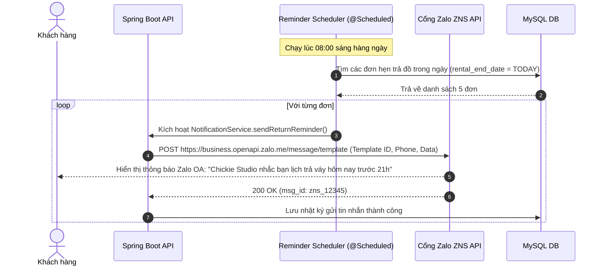

# Đặc Tả Tính Năng: Gửi Thông Báo Tự Động Qua Zalo ZNS & SMS

| Thuộc tính | Giá trị |
|---|---|
| **ID** | `SET-003` |
| **Tên tính năng** | Tích hợp gửi thông báo nhắc lịch thuê, xác nhận cọc qua Zalo ZNS & SMS Brandname |
| **Module** | SET (System Setting & Notification) |
| **Phạm vi** | SERVER |
| **Ưu tiên** | P2 - Tự động hóa chăm sóc khách hàng |
| **Trạng thái** | 📝 SPEC |
| **Người phụ trách** | Fullstack Dev & Tech Lead |
| **Ngày bắt đầu** | 2026-10-25 |
| **Ngày hoàn thành** | 2026-10-25 |
| **Phụ thuộc** | `BOK-001`, `BOK-003`, `PAY-001` |

---

## Mục Lục
1. [Mục Tiêu và Giá Trị Mang Lại](#1-mục-tiêu-và-giá-trị-mang-lại)
2. [Người Dùng Liên Quan](#2-người-dùng-liên-quan)
3. [Luồng Nghiệp Vụ Chính (Happy Path)](#3-luồng-nghiệp-vụ-chính-happy-path)
4. [Luồng Ngoại Lệ và Trường Hợp Biên](#4-luồng-ngoại-lệ-và-trường-hợp-biên)
5. [Quy Tắc Nghiệp Vụ (Business Rules)](#5-quy-tắc-nghiệp-vụ-business-rules)
6. [Giao Diện & Đa Ngôn Ngữ (UI & i18n)](#6-giao-diện--đa-ngôn-ngữ-ui--i18n)
7. [Đặc Tả API Backend](#7-đặc-tả-api-backend)
8. [Thay Đổi Cơ Sở Dữ Liệu](#8-thay-đổi-cơ-sở-dữ-liệu)
9. [Tiêu Chí Nghiệm Thu (Acceptance Criteria)](#9-tiêu-chí-nghiệm-thu-acceptance-criteria)
10. [Kế Hoạch Kiểm Thử](#10-kế-hoạch-kiểm-thử)
11. [Checklist Hoàn Thành (Definition of Done)](#11-checklist-hoàn-thành-definition-of-done)

---

## 1. Mục Tiêu và Giá Trị Mang Lại
- **Tự động hóa hoàn toàn việc chăm sóc và nhắc lịch (Zero manual effort)**: Giảm thiểu tình trạng nhân viên phải ngồi nhắn tin Zalo hay gọi điện cho từng khách hàng mỗi ngày.
- **Tỷ lệ đọc tin nhắn trên 90% với Zalo ZNS**: Zalo Notification Service (ZNS) gửi thông báo từ tài khoản Zalo Official Account (OA) có tích xanh của tiệm Chickie Studio, hiển thị chuyên nghiệp với logo, định dạng bảng rõ ràng và chi phí rẻ hơn SMS truyền thống.
- **Các kịch bản gửi tin nhắn tự động cốt lõi**:
  1. *Xác nhận đặt đơn & Hướng dẫn cọc*: Gửi ngay sau khi đặt đơn online thành công kèm mã VietQR.
  2. *Xác nhận đã nhận cọc*: Gửi thông báo đơn đã chuyển sang `DEPOSITED` an toàn.
  3. *Nhắc lịch nhận đồ*: Gửi lúc 08:00 sáng trước ngày nhận đồ 1 ngày.
  4. *Nhắc lịch trả đồ*: Gửi lúc 08:00 sáng của ngày hẹn trả đồ để khách chủ động sắp xếp thời gian.
  5. *Cảm ơn & Mời đánh giá*: Gửi sau khi đơn hoàn tất `COMPLETED`.

---

## 2. Người Dùng Liên Quan
- [x] **Khách hàng**: Nhận tin nhắn thông báo chính thức trên ứng dụng Zalo cá nhân.
- [x] **Hệ thống Server**: Tự động kích hoạt gửi tin theo sự kiện (`Event-driven`) và qua lịch trình định kỳ (`@Scheduled`).

---

## 3. Luồng Nghiệp Vụ Chính (Happy Path)



---

## 4. Luồng Ngoại Lệ và Trường Hợp Biên
- **Khách không có tài khoản Zalo hoặc chặn tin nhắn từ người lạ**: Hệ thống tự động fallback chuyển sang gửi tin nhắn SMS Brandname truyền thống (`Fallback to SMS`).

---

## 5. Quy Tắc Nghiệp Vụ (Business Rules)
- **BR-01**: Tuân thủ khung giờ gửi thông báo chuẩn: Tuyệt đối không gửi tin nhắn tự động trước 07:30 sáng và sau 21:30 tối để tránh làm phiền khách hàng.
- **BR-02**: Mọi lượt gửi thông báo đều phải lưu vết vào bảng `notification_logs` (thời gian, loại tin, trạng thái thành công/thất bại, chi phí) để kiểm soát ngân sách.

---

## 6. Giao Diện & Đa Ngôn Ngữ (UI & i18n)
- **CRM**: Tab "Nhật ký thông báo" trong chi tiết đơn hàng để nhân viên biết tin nhắn đã được gửi tới khách hay chưa.

---

## 7. Đặc Tả API Backend
- Service: `ZaloZnsService` và `SmsBrandnameService`.
- `POST /api/admin/notifications/manual-send`: Cho phép nhân viên bấm gửi lại tin nhắn thủ công nếu cần.

---

## 8. Thay Đổi Cơ Sở Dữ Liệu
- Tạo bảng `notification_logs` (Migration Flyway `V29__create_notification_logs_table.sql`):
```sql
CREATE TABLE `notification_logs` (
    `id` BIGINT AUTO_INCREMENT PRIMARY KEY,
    `booking_id` BIGINT NULL,
    `recipient_phone` VARCHAR(20) NOT NULL,
    `channel` VARCHAR(20) NOT NULL, -- ZALO_ZNS, SMS
    `template_type` VARCHAR(50) NOT NULL, -- BOOKING_CONFIRM, DEPOSIT_SUCCESS, PICKUP_REMINDER, RETURN_REMINDER, REVIEW_INVITE
    `status` VARCHAR(20) NOT NULL, -- SUCCESS, FAILED, RETRYING
    `provider_message_id` VARCHAR(100) NULL,
    `error_message` VARCHAR(255) NULL,
    `created_at` TIMESTAMP NOT NULL DEFAULT CURRENT_TIMESTAMP,
    INDEX `idx_notif_booking` (`booking_id`),
    INDEX `idx_notif_phone` (`recipient_phone`)
);
```

---

## 9. Tiêu Chí Nghiệm Thu (Acceptance Criteria)
- **Given**: Đơn cọc thành công.
- **When**: Trạng thái đổi sang `DEPOSITED`.
- **Then**: Khách nhận được thông báo Zalo OA xác nhận cọc thành công kèm mã đơn và ngày hẹn lấy đồ.

---

## 10. Kế Hoạch Kiểm Thử
- **Unit Test**: `NotificationServiceTest` (mock Zalo API response, test logic fallback SMS).
- **Coverage**: $\ge 85\%$.

---

## 11. Checklist Hoàn Thành (Definition of Done)
- [ ] Tài liệu đặc tả `SET-003` hoàn thành.
- [ ] Cập nhật `FEATURES.md` và `CHANGELOG.md`.
