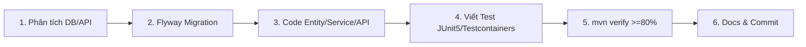

# 06 - Quy Trình Phát Triển API & Definition of Done (Server)

## 1. Quy Trình 6 Bước Triển Khai API



1. **Phân tích**: Xác định endpoint, request/response DTO và quan hệ dữ liệu trong DB.
2. **Flyway Migration**: Tạo file migration mới nếu có thay đổi bảng; cấm sửa migration cũ.
3. **Triển khai code**: Code Entity (kế thừa `BaseEntity`), Repository, Mapper, Service, Controller.
4. **Viết test tự động**: Viết test cho Service (JUnit 5 + Mockito), Controller (`@WebMvcTest`) và Integration test.
5. **Kiểm tra chất lượng**: Chạy `mvn clean verify`, đảm bảo JaCoCo coverage >= 80%.
6. **Cập nhật docs & commit**: Bổ sung đặc tả API vào `docs/` và commit theo Conventional Commits.

---

## 2. Các Lệnh Bắt Buộc Trước Khi Commit

```bash
mvn clean compile       # Kiểm tra biên dịch code và MapStruct generator
mvn test                # Chạy toàn bộ Unit Tests
mvn clean verify        # Kiểm tra toàn diện Integration tests và ngưỡng JaCoCo >= 80%
```

---

## 3. Quy Ước Commit (Conventional Commits)

```text
// ❌ SAI: Commit không rõ mục đích, gom nhiều việc chưa test
git commit -m "fix code va update db"

// ✅ ĐÚNG: Định dạng type(scope): description
git commit -m "feat(booking): tạo api đặt lịch thuê trang phục có pessimistic lock"
git commit -m "test(booking): bổ sung unit test xử lý xung đột trùng lịch thuê"
```
